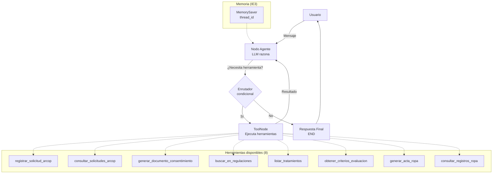
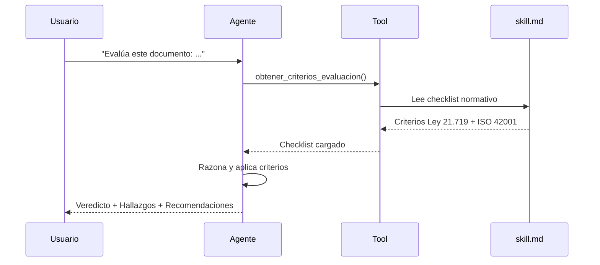
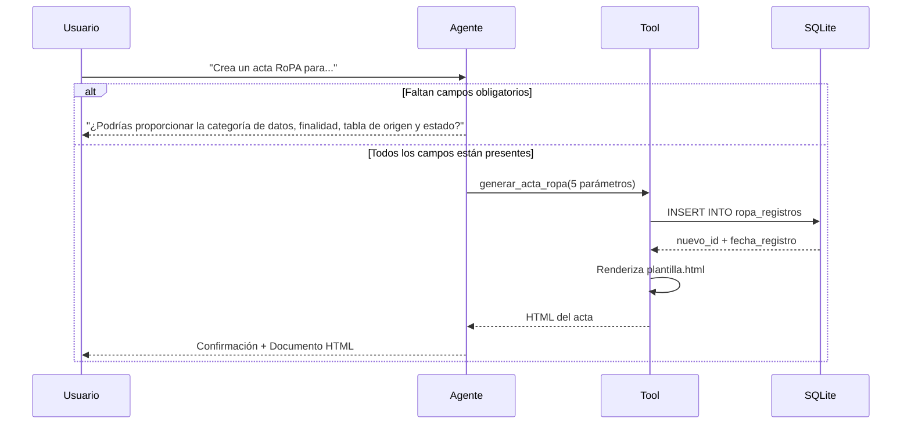

# 🛡️ Agente Funcional de Gobernanza de Datos e IA

Agente de IA basado en **LangGraph** que asiste a una organización en el cumplimiento de la **Ley 21.719** de Protección de Datos Personales de Chile y la norma **ISO 42001** (Sistema de Gestión de Inteligencia Artificial).

El agente integra herramientas de **consulta**, **escritura**, **razonamiento** y **recuperación de contexto** (RAG sobre skills locales), con memoria persistente entre turnos, y expone una interfaz conversacional en **Streamlit**.

---

## 📚 Tabla de contenidos

- [Descripción general](#-descripción-general)
- [Arquitectura y stack tecnológico](#-arquitectura-y-stack-tecnológico)
- [Estructura del proyecto](#-estructura-del-proyecto)
- [Diagrama de orquestación del agente](#-diagrama-de-orquestación-del-agente)
- [Requisitos previos](#-requisitos-previos)
- [Instalación y ejecución](#-instalación-y-ejecución)
- [Uso del agente](#-uso-del-agente)
- [Herramientas y skills](#-herramientas-y-skills)
- [Evidencia de pruebas](#-evidencia-de-pruebas)
- [Uso de inteligencia artificial](#-uso-de-inteligencia-artificial)
- [Autores](#-autores)
- [Referencias](#-referencias)

---

## 🎯 Descripción general

El proyecto implementa un **agente funcional** que apoya las siguientes tareas organizacionales:

| Capacidad | Descripción | 
|-----------|-------------|
| Gestión ARCOP | Registro y consulta de solicitudes de Acceso, Rectificación, Cancelación, Oposición y Portabilidad. | 
| Generación de documentos | Creación de consentimientos informados en HTML a partir de plantillas parametrizadas. | 
| Evaluación normativa | Auditoría de documentos contra los criterios de la Ley 21.719 y la ISO 42001. |
| Inventario de tratamientos | Consulta del registro de actividades de tratamiento y su nivel de riesgo. | 
| **Tramitación RoPA** | **Generación de Actas de Registro de Actividades de Tratamiento (art. 14 Ley 21.719 · cláusula 7.5 ISO 42001) y consulta del historial formal.** | 
| Recuperación de conocimiento | Búsqueda en la base de conocimiento normativa local (RAG sobre `skill.md`). | 

---

## 🏗️ Arquitectura y stack tecnológico

| Componente | Tecnología | Justificación |
|------------|-----------|---------------|
| Framework de agentes | **LangGraph** | Permite modelar el flujo como un grafo dirigido con estado, aristas condicionales y ciclos ReAct, lo que satisface la planificación adaptativa. |
| LLM | **Groq** (`openai/gpt-oss-120b`) | Inferencia ultrarrápida, tier gratuito y soporte nativo de *Tool Calling*, ideal para una demo en vivo fluida. |
| Interfaz | **Streamlit** | Permite un prototipo visual rápido y renderiza HTML generado por el agente. |
| Base de datos | **SQLite** | Autocontenida, sin servidor, ideal para simular el entorno organizacional. |
| Memoria del agente | **MemorySaver** (LangGraph) | Persiste el historial conversacional por `thread_id`. |
| Contenedores | **Docker** | Portabilidad del entorno de ejecución. |

---

## 📁 Estructura del proyecto

```text
proyecto_gobernanza/
│
├── agent_app/                          # Cerebro del agente
│   ├── __init__.py
│   ├── agent.py                        # Grafo LangGraph + memoria
│   ├── prompts.py                      # Prompts del supervisor y evaluador
│   └── tools.py                        # Herramientas (tools) del agente
│
├── skills/                             # Habilidades modulares (RAG local)
│   ├── generar_consentimiento/
│   │   ├── skill.md                    # Instrucciones de la skill
│   │   ├── plantilla.html              # Plantilla del documento
│   │   └── queries.sql                 # Consultas de apoyo
│   ├── evaluar_documento/
│   │   ├── skill.md                    # Checklist normativo (Ley + ISO)
│   │   └── queries.sql
│   ├── gestion_arcop/
│   │   ├── skill.md                    # Flujo de gestión ARCOP
│   │   └── queries.sql
│   └── tramitacion_ropa/               # NUEVA SKILL
│       ├── skill.md                    # Flujo de tramitación RoPA
│       ├── plantilla.html              # Plantilla del acta formal
│       └── queries.sql                 # Consultas de apoyo
│
├── data/
│   └── seed.py                         # Poblamiento de la BD con datos de ejemplo
│
├── app.py                              # Interfaz Streamlit
├── Dockerfile                          # Imagen del proyecto
├── requirements.txt                    # Dependencias Python
├── empresa_gobernanza.db               # Base de datos SQLite (generada)
├── .env.example                        # Plantilla de variables de entorno
├── .gitignore
└── README.md                           # Este archivo
```

### Esquema de la base de datos

| Tabla | Propósito | Registros de ejemplo |
|-------|-----------|----------------------|
| `titulares` | Personas cuyos datos personales son tratados por la organización. | 7 |
| `tratamientos` | Inventario interno de actividades de tratamiento (ISO 42001). | 5 |
| `solicitudes_arcop` | Ciclo de vida de los derechos ARCOP ejercidos por los titulares. | 6 |
| `ropa_registros` | **Actas formales de Registro de Actividades de Tratamiento (RoPA).** | **2** |

---

## 🔀 Diagrama de orquestación del agente

El agente sigue un patrón **ReAct** (Reasoning + Acting) orquestado por LangGraph:



### Flujo de evaluación de documentos (patrón RAG en dos pasos)

Para cumplir con el principio de **separación entre recuperación y razonamiento**, la evaluación de documentos sigue este flujo:



### Flujo de tramitación RoPA (patrón de validación previa)

Para la generación de actas RoPA se aplica el patrón de **validación de parámetros obligatorios antes de la escritura**:



---

## ⚙️ Requisitos previos

- **Python** 3.11 o superior
- **Git**
- **Docker** (opcional, para ejecución containerizada)
- **Cuenta en Groq** para obtener una API Key gratuita → [console.groq.com](https://console.groq.com/)

---

## 🚀 Instalación y ejecución

### 1. Clonar el repositorio

```bash
git clone https://github.com/<usuario>/proyecto_gobernanza.git
cd proyecto_gobernanza
```

### 2. Crear un entorno virtual e instalar dependencias

```bash
python -m venv venv

# Windows
venv\Scripts\activate
# Linux/Mac
source venv/bin/activate

pip install -r requirements.txt
```

### 3. Configurar la API Key

Crea un archivo `.env` en la raíz del proyecto (basado en `.env.example`):

```env
GROQ_API_KEY=tu_api_key_de_groq_aqui
```

### 4. Inicializar la base de datos

```bash
python data/seed.py
```

**Salida esperada:**

```
✅ Base de datos creada y poblada con éxito.
   - 7 titulares
   - 5 actividades de tratamiento
   - 6 solicitudes ARCOP
   - 2 registros RoPA
```

> 💡 **Nota:** el archivo `agent_app/tools.py` ejecuta automáticamente una verificación de integridad de la BD al importarse. Si detecta que falta alguna tabla (incluida `ropa_registros`), la regenera sola.

### 5. Ejecutar la aplicación

```bash
streamlit run app.py
```

La aplicación estará disponible en `http://localhost:8501`.

### 🔁 Alternativa con Docker

```bash
docker build -t agente-gobernanza .
docker run -p 8501:8501 --env-file .env agente-gobernanza
```

---

## 💬 Uso del agente

Una vez abierta la interfaz, puedes interactuar con el agente mediante lenguaje natural. Ejemplos de consultas válidas:

| Intención | Ejemplo de prompt |
|-----------|-------------------|
| Inventario de tratamientos | *"Muéstrame el inventario de tratamientos y su nivel de riesgo"* |
| Registrar ARCOP | *"Registra una solicitud de cancelación para el titular 2"* |
| Consultar ARCOP | *"¿Qué solicitudes tiene el titular 3?"* |
| Generar consentimiento | *"Genera un consentimiento para Ana Gómez para newsletter mensual"* |
| Evaluar documento | *"Evalúa este documento: 'Yo autorizo...'"* |
| Consultar normativa | *"¿Qué plazos da la ley para responder una solicitud ARCOP?"* |
| **Generar acta RoPA** | ***"Crea un acta RoPA para 'Marketing por email', datos de contacto, finalidad newsletter, tabla titulares, estado aprobado"*** |
| **Consultar actas RoPA** | ***"Muéstrame los registros RoPA generados"*** |

---

## 🧰 Herramientas y skills

### Herramientas (`agent_app/tools.py`)

| Herramienta | Tipo | Descripción |
|-------------|------|-------------|
| `registrar_solicitud_arcop` | Escritura | Inserta una nueva solicitud ARCOP en SQLite. |
| `consultar_solicitudes_arcop` | Consulta | Lista las solicitudes de un titular. |
| `generar_documento_consentimiento` | Escritura | Renderiza la plantilla HTML con los datos del titular. |
| `buscar_en_regulaciones` | Recuperación | Búsqueda semántica en la base normativa local. |
| `listar_tratamientos` | Consulta | Devuelve el inventario ISO 42001 con nivel de riesgo. |
| `obtener_criterios_evaluacion` | Recuperación | Carga el checklist de la skill `evaluar_documento`. |
| **`generar_acta_ropa`** | **Escritura** | **Inserta un registro RoPA en SQLite y renderiza el acta formal en HTML.** |
| **`consultar_registros_ropa`** | **Consulta** | **Lista los registros RoPA existentes con su estado y fecha.** |

### Skills (`skills/`)

Cada skill es un **módulo autocontenido** con:

- `skill.md` → instrucciones semánticas que el agente recupera como contexto.
- `queries.sql` → consultas reutilizables sobre la base de datos.
- `plantilla.html` (cuando aplica) → plantilla parametrizable.

Este diseño implementa el patrón **"skills como plugins"**: extender el agente con una nueva capacidad solo requiere agregar una carpeta nueva, sin tocar el código del grafo.

### Detalle de la skill `tramitacion_ropa`

Esta skill implementa el **Registro de Actividades de Tratamiento (RoPA)** exigido por el **art. 14 de la Ley 21.719** y la **cláusula 7.5 de la ISO 42001**. El agente solo genera el acta cuando dispone de los **5 parámetros obligatorios**:

| Parámetro | Ejemplo | Validación |
|-----------|---------|------------|
| `nombre_tratamiento` | "Marketing por email" | Obligatorio |
| `categoria_datos` | "Identificación, contacto" | Obligatorio |
| `finalidad` | "Envío de newsletters" | Obligatorio |
| `tabla_origen` | "titulares" | Obligatorio |
| `estado_solicitud` | "Aprobado" | Obligatorio |

Si falta alguno, el agente **no inventa datos** y solicita la información faltante al usuario.

---

## 🧪 Evidencia de pruebas

### Caso 1 — Evaluación de documento NO conforme

**Input:**
> *"Evalúa este documento: 'Yo, Juan Pérez, autorizo a la empresa para tratar mis datos con cualquier finalidad que estime conveniente. No se informan plazos ni derechos del titular.'"*

**Output:**
```
Veredicto: NO CUMPLE
Puntuación: 2/10
Hallazgos Ley 21.719: 6 fallas identificadas
Hallazgos ISO 42001: 4 fallas identificadas
Recomendaciones: 8 acciones concretas
```

### Caso 2 — Evaluación de documento conforme (contraste)

**Input:** consentimiento completo con responsable, finalidad, plazos, derechos ARCOP, medidas de seguridad y supervisión humana.

**Output:**
```
Veredicto: CUMPLE PARCIALMENTE
Puntuación: 8/10
Observaciones: transparencia algorítmica y gestión de riesgos mejorables
Recomendaciones: 5 acciones de refinamiento
```

> Este contraste demuestra que el agente **no responde con plantillas fijas**, sino que razona sobre el contenido real.

### Caso 3 — Memoria entre turnos

1. *"Registra una cancelación para el titular 2"* → confirmación exitosa.
2. *"¿Puedes confirmar el estado de las solicitudes del titular 2?"* → el agente recuerda el registro anterior y devuelve ambas solicitudes (la histórica y la recién creada). 

### Caso 4 — Generación de acta RoPA (skill nueva)

**Input:**
> *"Crea un acta RoPA para el tratamiento 'Personalización de ofertas con IA', categoría de datos 'historial de compras y preferencias', finalidad 'recomendaciones personalizadas mediante modelos de machine learning', tabla de origen 'titulares', estado de solicitud 'En revisión'."*

**Output:**
```
✅ Acta RoPA registrada exitosamente con ID 3.

Aquí tienes el documento HTML:

```html
<!DOCTYPE html>
<html lang="es">
...
```

El acta se **renderiza como documento formal** en Streamlit (con encabezado, tabla de campos, referencia normativa y firma).

### Caso 5 — Validación de parámetros incompletos (control de calidad)

**Input:**
> *"Crea un acta RoPA para el tratamiento 'Campaña de reenganche'."*

**Comportamiento esperado:** El agente **no genera el acta**. En su lugar, pregunta al usuario por los 4 campos faltantes (categoría, finalidad, tabla de origen y estado). Evidencia directa de **IE7 (decisiones adaptativas)**.

---

## 🤖 Uso de inteligencia artificial

De acuerdo con las indicaciones de la evaluación, se declara el siguiente uso de herramientas de IA durante el desarrollo:

| Herramienta | Uso | Validación |
|-------------|-----|-----------|
| **DeepSeek** | Apoyo en la redacción del marco teórico y revisión de estilo del código. | Todas las sugerencias fueron revisadas, adaptadas y probadas por los integrantes. |
| **GitHub Copilot** | Autocompletado de código en Python (imports, docstrings). | El código final fue auditado manualmente. |
| **Groq (LLM de producción)** | Motor de razonamiento del propio agente. | Es parte de la solución, no del proceso de redacción. |

**Ideas, análisis, decisiones de diseño y justificaciones técnicas son de autoría propia.** Las reflexiones individuales incluidas en el informe fueron redactadas sin asistencia de IA, conforme a la prohibición explícita de la pauta.

---

## 👥 Autores

- **Millaray Paillafil**
- **Jerson Reyes** 

**Asignatura:** ISY0101 — Ingeniería de Soluciones con IA
**Evaluación:** Parcial N°2 — Desarrollo de un Agente Funcional
**Institución:** Duoc UC — Escuela de Informática y Telecomunicaciones
**Año:** 2025

---

## 📚 Referencias

- Biblioteca del Congreso Nacional de Chile. (2024). *Ley 21.719: Regula la protección y el tratamiento de los datos personales y crea la Agencia de Protección de Datos Personales* (art. 14 sobre el registro de actividades de tratamiento). https://www.bcn.cl/leychile
- International Organization for Standardization. (2023). *ISO/IEC 42001:2023 — Information technology — Artificial intelligence — Management system* (cláusula 7.5 sobre información documentada). https://www.iso.org/standard/81230.html
- Chase, H. (2024). *LangGraph: Building stateful, multi-actor applications with LLMs* [Documentación oficial]. LangChain. https://langchain-ai.github.io/langgraph/
- LangChain. (2024). *LangChain Documentation*. https://python.langchain.com/
- Groq. (2024). *Groq API Reference*. https://console.groq.com/docs
- Streamlit. (2024). *Streamlit Documentation*. https://docs.streamlit.io/

---

## 📄 Licencia

Proyecto desarrollado con fines académicos para la asignatura ISY0101 de Duoc UC. Todos los datos utilizados son simulados.